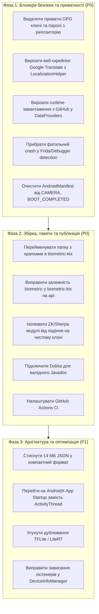

# Суворе Код-Ревью та Оцінка Готовності до Публікації
**Проєкт:** `AdvancedBiometricPromptCompat` (`dev.skomlach:biometric`)  
**Версія в конфігурації:** `2.4.rc-48`  
**Дата аудиту:** 22 вересня 2026 р.  
**Цільовий репозиторій публікації:** Maven Central / Sonatype  

---

## 1. Загальний вердикт (Executive Verdict)

> [!CAUTION]
> **ВЕРДИКТ: НЕ ГОТОВИЙ ДО РЕЛІЗУ (BLOCKED / RELEASE REJECTED)**
> 
> Поточна кодова база містить критичні блокери у сферах:
> 1. **Безпека:** Приватні GPG-ключі та відкриті паролі в робочій директорії.
> 2. **Приватність і політики Google Play:** Прихований веб-скрейпінг Google Translate та динамічне завантаження JSON із raw GitHub у рантаймі.
> 3. **Пайплайн публікації та артефакти:** Збірка падає на чистому клоні (відсутні vendor SDK); у `biometric-ktx` пошкоджено дерево каталогів і порожній POM без залежності на `:biometric`; відсутній справжній Javadoc/Dokka.
> 4. **Ліцензійна чистота:** Відсутність підтверджених прав на поширення вбудованих моделей ML (`.tflite`) та пропрієтарних бібліотек.
> 
> Публікація в поточному стані призведе до компрометації ключів, відхилення додатків у Google Play Store, блокування IP-адрес через неавторизований скрейпінг та збоїв у користувачів бібліотеки.

---

## 2. Зведена матриця готовності

| Домен оцінки | Статус | Рівень критичності | Головний фактор |
| :--- | :--- | :--- | :--- |
| **Критична безпека та ключі** | ❌ Не пройдено | **P0 (Блокер)** | Приватні GPG-ключі та паролі в робочому просторі |
| **Приватність і мережевий стек** | ❌ Не пройдено | **P0 (Блокер)** | Неавторизований скрейпінг Google Translate та raw GitHub у рантаймі |
| **Пайплайн публікації та POM** | ❌ Не пройдено | **P0 (Блокер)** | Чистий клон падає через ZK/Sherpa; POM для `biometric-ktx` порожній; пошкоджено структуру пакетів ktx |
| **Ліцензії та сторонній код** | ❌ Не пройдено | **P0 (Блокер)** | Відсутність прав на розповсюдження моделей TFLite та пропрієтарних SDK |
| **Архітектура та ресурси** | ⚠️ Потребує змін | **P1 (Високий)** | 14 МБ JSON-файлів у `common`; розпакування `SystemUI.apk`; не-SDK рефлексія `ActivityThread` |
| **Стабільність та рантайм** | ⚠️ Потребує змін | **P1 (Високий)** | Краш додатку при звичайному дебагу (Frida/debugger detection); витік лістенерів у `DeviceInfoManager` |
| **Тестове покриття та CI/CD** | ⚠️ Недостатньо | **P1 (Високий)** | 0 тестів для `biometric-ktx` та `biometric-api`; відсутність GitHub Actions CI |

---

## 3. Детальний аналіз знайдених проблем

### 3.1. Безпека, конфіденційність та секрети (Security & Privacy)

#### 🔴 P0-1: Наявність приватних ключів підпису та відкритих паролів
* **Файли:**
  - `26DCB3BAD3D40B7DD79928BED6D5A91517F0A15E.gpg.private`
  - `s komlach - private.asc`
  - `26DCB3BAD3D40B7DD79928BED6D5A91517F0A15E.pgp`
  - `26DCB3BAD3D40B7DD79928BED6D5A91517F0A15E.gpg.public` (не заігнорений у git!)
  - `local.properties` (містить відкриті `signing.password`, `ossrhPassword`, `ossrTokenPassword`)
* **Ризик:** 
  Хоча `.gitignore` містить шаблони для приватних ключів, їх постійне знаходження в корені проєкту створює критичний ризик випадкового потрапляння в git-індекс (`git add -f`, зміна `.gitignore`) або в архів джерел/артефактів. Публічний ключ взагалі висить у невідстежуваних файлах. Паролі від Sonatype та Nexus лежать відкритим текстом на диску.
* **Вимога:**
  Винести приватні ключі підпису та облікові дані в захищене сховище операційної системи (або `~/.gradle/gradle.properties`), повністю видалити секретні файли з робочого каталогу репозиторію.

---

#### 🔴 P0-2: Неавторизований веб-скрейпінг Google Translate та порушення Google Play Policies
* **Файл:** `common/src/main/java/dev/skomlach/common/translate/LocalizationHelper.kt` (рядки 44–52, 469–569)
* **Проблема:**
  У разі відсутності перекладу на поточну мову, бібліотека відправляє тексти інтерфейсу та системні рядки на недокументовані endpoints Google Translate:
  `https://translate.googleapis.com/translate_a/single?client=gtx` та `https://clients5.google.com/translate_a/t?client=dict-chrome-ex`, підміняючи `User-Agent` на набір десктопних браузерів (Chrome 130 на Windows/Mac).
* **Ризик:**
  1. **Пряме порушення Google Terms of Service** (скрейпінг без офіційного API-ключа).
  2. **Порушення Google Play Data Safety & Privacy Policy:** Біометрична бібліотека здійснює неоголошені вихідні HTTP-запити з текстами додатку. Додатки, що використовують бібліотеку, ризикують бути заблокованими або відхиленими модерацією Play Store.
  3. **Блокування за IP (HTTP 429 Too Many Requests / Captcha):** У продакшені масові запити з мобільних IP-пулів миттєво баняться Google, спричиняючи непередбачувані затримки та збої відображення UI.
* **Вимога:**
  Повністю видалити динамічний переклад через мережу. Локалізація має базуватися виключно на скомпільованих ресурсах додатку (`res/values-*/strings.xml`).

---

#### 🔴 P0-3: Динамічне завантаження специфікацій пристроїв з GitHub у рантаймі
* **Файли:**
  - `common/src/main/java/dev/skomlach/common/device/DeviceSpecManager.kt` (рядки 40–54)
  - `common/src/main/java/dev/skomlach/common/device/DataProviders.kt` (рядки 102–140)
* **Проблема:**
  Бібліотека звертається за raw-посиланнями на GitHub:
  `https://github.com/sergeykomlach/AdvancedBiometricPromptCompat/blob/main/common/src/main/assets/devices/specifications.json?raw=true`
  та намагається завантажити багатометрові JSON-файли в рантаймі через фоновий екзекутор.
* **Ризик:**
  Мережеві виклики на GitHub під час ініціалізації або показу біометрії:
  - У корпоративних мережах або за фаєрволом завантаження падає.
  - GitHub обмежує швидкість (rate limit) для raw-запитів.
  - Цілісність завантаженого JSON ніяк криптографічно не перевіряється (MITM/Tampering ризик).
  - Порушення концепції автономності та безпеки системного компонента.
* **Вимога:**
  Виключити будь-які мережеві запити з рантайму біометричної бібліотеки. Всі необхідні правила та бази датчиків мають постачатися локально в оптимізованому двійковому форматі (або зашиті в код), без звернень до Інтернету.

---

#### 🔴 P0-4: Агресивний захист від Frida призводить до падіння додатку при легітимному налагодженні
* **Файли:**
  - `biometric/src/main/java/dev/skomlach/biometric/compat/BiometricPromptCompat.kt` (рядки 1930–1938)
  - `common/src/main/java/dev/skomlach/common/protection/HookDetection.kt` (рядки 50–75, 188–200)
* **Проблема:**
  1. Метод `HookDetection.hooksDetection()` перевіряє `Debug.isDebuggerConnected()`. Якщо підключено стандартний Android Studio Debugger, він повертає `true`.
  2. Далі в `BiometricPromptCompat.AuthenticationCallback.onSucceeded()`:
     ```kotlin
     if (reference.get() && tmp - authCallTimeStamp.get() <= skipTimeout) {
         throw BiometricAuthException("Biometric flow hooking detected")
     }
     ```
     `BiometricAuthException` є `RuntimeException`. Виклик здійснюється на `MainThread`. Як наслідок, будь-який розробник, який запустив свій додаток під звичайним дебагером у студії та швидко пройшов біометрію (або на емуляторі), отримує **Fatal Crash** додатку.
  3. `checkFridaPorts()` сканує порти `27042` та `27047` через `Socket(InetAddress.getByName("localhost"), port)`, що може порушувати StrictMode та викликати мережеві винятки за відсутності мережевих дозволів.
* **Вимога:**
  Не кидати неперехоплені винятки в головний потік. Замість аварійного завершення процесу передавати відповідний `AuthenticationFailureReason.HARDWARE_ERROR` або `SECURITY_RISK` у зворотний виклик `onFailed()`. Перевірка на дебагер не повинна ламати нормальний процес розробки додатків споживачів.

---

#### 🔴 P0-5: Впровадження надлишкових чутливих дозволів та Receiver на BOOT_COMPLETED
* **Файл:** `biometric/src/main/AndroidManifest.xml` (рядки 42–95)
* **Проблема:**
  При підключенні бібліотеки `dev.skomlach:biometric` у маніфест кінцевого додатку автоматично додаються:
  - `android.permission.CAMERA` (небезпечний дозвіл, вимагає рантайм-запиту та обґрунтування в Google Play)
  - `android.permission.RECEIVE_BOOT_COMPLETED` (вимагає окремого обґрунтування для фонової роботи)
  - `android.permission.POST_NOTIFICATIONS`
  - `android.permission.HIDE_OVERLAY_WINDOWS`
  - `android.permission.WAKE_LOCK`
  - Експортований `<receiver android:name="...DeviceUnlockedReceiver" android:exported="true">` з фільтром на `BOOT_COMPLETED`.
* **Ризик:**
  Додаток, якому потрібен лише звичайний відбиток пальця, після підключення бібліотеки несподівано отримує `CAMERA` та автозапуск при перезавантаженні телефону. Це гарантований блокер для банківських, fintech та безпекових додатків.
* **Вимога:**
  Винести дозволи камери, звукозапису та `RECEIVE_BOOT_COMPLETED` в опціональні субмодулі (`biometric-custom-face-tf`, `biometric-custom-voice`) або залишити їх декларування виключно кінцевому додатку за потребою. Видалити автозапуск на завантаженні системи або зробити його динамічно реєстрованим.

---

### 3.2. Пайплайн публікації та збірка (Build & Publishing)

#### 🔴 P0-6: Неможливість зібрати проєкт на чистому клоні (CI/CD Blocker)
* **Файли:**
  - `biometric-zkfinger/build.gradle` (рядки 8–15)
  - `biometric-sherpa-onnx/build.gradle` (рядки 7–12)
* **Проблема:**
  ```groovy
  def missingZkFingerSdkJars = localZkFingerSdkJars.findAll { !it.isFile() }
  if (!missingZkFingerSdkJars.isEmpty()) {
      throw new GradleException("biometric-zkfinger requires official ZKTeco JARs...")
  }
  ```
  Ці файли лежать у каталогах `vendor-sdk/`, які прописані в `.gitignore`. При клонуванні проєкту на чистій машині чи в CI/CD сервері Gradle зупиняється з помилкою конфігурації ще до виконання будь-якого таску (`./gradlew help` або `assemble` не можуть відпрацювати).
* **Вимога:**
  Модулі з пропрієтарними SDK повинні або бути опціональними/виключеними з базової конфігурації `settings.gradle`, або мати grace-fallback (компілюватися зі заглушками), або не викидати фатальну помилку на фазі конфігурації проєкту, якщо ці модулі не викликаються явно.

---

#### 🔴 P0-7: Пошкоджений каталог з крапками в `biometric-ktx`
* **Каталог:** `biometric-ktx/src/main/java/dev.skomlach.biometric.compat`
* **Проблема:**
  Замість вкладених папок `dev/skomlach/biometric/compat` створено папку з ім'ям `dev.skomlach.biometric.compat` (з крапками в імені каталогу).
  У файлі `publish-mavencentral.gradle` таск `androidSourcesJar` запаковує цей каталог «як є». В результаті архів `biometric-ktx-*-sources.jar` містить некоректну структуру шляхів, через що IDE (Android Studio / IntelliJ) не можуть автоматично прив'язати вихідні коди та навігувати по них.
* **Вимога:**
  Перемістити файли з каталогу `dev.skomlach.biometric.compat` у нормальне дерево каталогів `dev/skomlach/biometric/compat/`.

---

#### 🔴 P0-8: Відсутність транзитивної залежності в POM для `biometric-ktx`
* **Файли:**
  - `biometric-ktx/build.gradle` (рядок 33: `compileOnly project(":" + libArtifactId_biometric)`)
  - `scripts/publish-mavencentral.gradle` (рядки 107–129)
* **Проблема:**
  `publish-mavencentral.gradle` вручну генерує секцію `<dependencies>` у POM-файлі, збираючи виключно конфігурації `releaseImplementation` та `implementation`. Оскільки в `biometric-ktx` залежність на головний модуль `:biometric` позначена як `compileOnly`, вона **повністю відсутня в згенерованому POM**.
  Розробник, який підключає бібліотеку:
  ```groovy
  implementation 'dev.skomlach:biometric-ktx:2.4.rc-48'
  ```
  отримує розширення, але не отримує самого ядра `dev.skomlach:biometric`. Додаток впаде з `ClassNotFoundException / NoClassDefFoundError` під час запуску.
* **Вимога:**
  У `biometric-ktx/build.gradle` змінити `compileOnly` на `api project(":" + libArtifactId_biometric)` та переконатися, що генератор POM коректно експортує `api` та `implementation` залежності з тегом `<scope>compile</scope>`.

---

#### 🔴 P0-9: Ручна публікація AAR замість стандартного SoftwareComponent
* **Файл:** `scripts/publish-mavencentral.gradle` (рядок 71)
* **Проблема:**
  Використовується застарілий підхід ручного зазначення шляху:
  `artifact("$buildDir/outputs/aar/${project.getName()}-release.aar")`
  разом з ручним XML-парсингом залежностей. Сучасний Android Gradle Plugin (AGP 7.x–8.x+) вимагає використання `from(components.release)` з публікацією Gradle Metadata (`.module`).
* **Вимога:**
  Перевести публікацію на стандартний механізм AGP `publishing { singleVariant("release") { withSourcesJar(); withJavadocJar() } }` або перевірені плагіни на кшталт `com.vanniktech.maven.publish`.

---

#### 🔴 P0-10: Відсутність згенерованої документації Dokka / Javadoc
* **Файл:** `scripts/publish-mavencentral.gradle` (рядки 7–16), `docs/publishing/JAVADOC-README.md`
* **Проблема:**
  Таск `androidJavadocJar` пакує звичайний текстовий файл `README.md` з посиланням на GitHub під виглядом javadoc-архіву. Це фіктивна заглушка виключно для проходження валідації Sonatype.
* **Вимога:**
  Для публічної бібліотеки обов'язково підключити плагін **Dokka** (`org.jetbrains.dokka`) для автоматичної генерації повноцінної HTML/Javadoc документації з Kotlin KDoc коментарів.

---

#### 🔴 P0-11: Повна відсутність CI/CD автоматизації
* **Проблема:**
  У репозиторії відсутня директорія `.github/workflows`. Відсутні перевірки PR, лінтингу, юніт-тестів та деплою на віддалених серверах. Публікація можлива лише локально з робочої станції через ручний запуск скріпта, що суперечить сучасним стандартам надійності Open Source бібліотек.
* **Вимога:**
  Створити GitHub Actions воркфлоу для автоматичної верифікації (збірка, модульні тести, lint, detekt) та релізу через GitHub Releases / Sonatype Portal за допомогою тегів версій.

---

### 3.3. Ліцензійна чистота та сторонній код (Licensing & Legal)

#### 🔴 P0-12: Поширення навчених ML-моделей без чіткого ліцензійного походження
* **Файли:**
  - `biometric-custom-face-tf/src/main/assets/tf_bio/FaceAntiSpoofing.tflite` (4.11 МБ)
  - `biometric-custom-face-tf/src/main/assets/tf_bio/mobile_face_net.tflite` (5.24 МБ)
* **Проблема:**
  У репозиторії знаходяться скомпільовані бінарні ваги нейромереж.
  У документації проєкту (`docs/superpowers/plans/2026-09-21-biometric-hardening-roadmap.md`) у пункті `LIC-02` зафіксовано:
  *"Establish redistribution rights for Huawei LocalAuthentication and MobileFaceNet/deepfake assets; get the applicable ZKTeco SDK agreement. If unavailable, choose a compatible removal/application-supplied migration before publishing."*
  Цей пункт досі залишається відкритим ("External evidence required").
* **Вимога:**
  До надання документальних підтверджень ліцензій на вільне комерційне розповсюдження цих моделей модуль `biometric-custom-face-tf` не може бути опублікований у відкритих публічних репозиторіях від імені автора бібліотеки.

---

### 3.4. Архітектура, продуктивність та системні виклики (Architecture & Performance)

#### 🟡 P1-1: 14 Мегабайт статичних JSON-файлів у модулі `common`
* **Каталог:** `common/src/main/assets/devices/`
  - `by_model.json` — 5.12 МБ
  - `devices.json` — 0.68 МБ
  - `specifications.json` — 8.21 МБ
* **Проблема:**
  Кожен додаток, який підключає навіть базовий `dev.skomlach:biometric`, отримує у фінальний APK понад 14 МБ нестиснених JSON-ресурсів.
  Більше того, у `DeviceSpecManager.kt` (рядок 89) викликається:
  `val lowerCasedFullJson = fullJson.lowercase()`
  що створює в купі (heap) копію рядка розміром 8.2 МБ, після чого виконується пошук підрядків у 8 мільйонах символів.
* **Вимога:**
  Перевести базу специфікацій пристроїв у компактну бінарну базу даних (SQLite / Room / FlatBuffers / Protobuf) або скомпільовану Trie/Bloom-фільтр структуру, скоротивши об'єм до сотень кілобайт і позбувшись виділення десятків мегабайт пам'яті в JVM.

---

#### 🟡 P1-2: Небезпечна рефлексія внутрішніх класів Android (`ActivityThread`)
* **Файл:** `common/src/main/java/dev/skomlach/common/contextprovider/AndroidContext.kt` (рядки 42–55, 120–136)
* **Проблема:**
  Отримання контексту реалізовано через приховане API:
  `ActivityThread.currentApplication()` та `AppGlobals.getInitialApplication()`.
  Починаючи з Android 9–14+, Google планомірно обмежує non-SDK interfaces (greylist/blacklist). Якщо система блокує виклик, `AndroidContext.appContext` викидає `RuntimeException("Application is NULL")`.
* **Вимога:**
  Перейти на стандартний Google-рекомендований механізм **AndroidX App Startup** (`androidx.startup:startup-runtime`) з реалізацією `Initializer<Context>` або надати публічний метод `BiometricPromptCompat.init(context)`.

---

#### 🟡 P1-3: Розбір APK-файлу `SystemUI` у рантаймі
* **Файл:** `biometric/src/main/java/dev/skomlach/biometric/compat/impl/dialogs/SystemBiometricDialogResources.kt` (рядки 76–200)
* **Проблема:**
  Бібліотека шукає шлях до APK `com.android.systemui`, відкриває його через `ZipFile` та парсить системні XML-файли для копіювання точних відступів та стилів діалогу.
  На багатьох прошивках вендорів (MIUI, HyperOS, ColorOS, EMUI) доступ до APK інших додатків заблокований SELinux-політиками або змінені пакети біометрії, що спричиняє винятки та затримки при відкритті діалогу.
* **Вимога:**
  Використовувати стабільні системні теми Material Design або власні адаптивні ресурси без спроб відкривати zip-архіви чужих системних процесів.

---

#### 🟡 P1-4: Дублювання залежностей TensorFlow Lite та LiteRT
* **Файл:** `biometric-custom-face-tf/build.gradle` (рядки 38–43)
* **Проблема:**
  Модуль одночасно підключає:
  - `org.tensorflow:tensorflow-lite:2.17.0`
  - `com.google.ai.edge.litert:litert:1.4.2`
  LiteRT є наступником TensorFlow Lite. Підключення обох бібліотек веде до дублювання нативних бібліотек (`.so`) у фінальному додатку та значного збільшення ваги APK.
* **Вимога:**
  Залишити одну бібліотеку (рекомендовано LiteRT або TFLite).

---

#### 🟡 P1-5: Необроблена помилка в `DeviceInfoManager` призводить до зависання черги
* **Файл:** `common/src/main/java/dev/skomlach/common/device/DeviceInfoManager.kt` (рядки 75–87)
* **Проблема:**
  У фоновому блоці:
  ```kotlin
  try {
      ...
  } catch (e: Exception) {
      running.set(false)
  }
  ```
  Якщо стається помилка (наприклад, `OutOfMemoryError` при читанні JSON або пошкоджений кеш), `notifyListeners` ніколи не викликається, список `listeners` не очищається, і всі колбеки, які чекають `onReady`, зависають назавжди.
* **Вимога:**
  У блоці catch сповіщати слухачів про помилку (`it.onReady(null)` або onError) та обов'язково очищати чергу слухачів.

---

## 4. План дій для виправлення (Remediation Roadmap)



---

## 5. Підсумковий висновок

Бібліотека має надзвичайно багатий функціонал та глибоку сумісність зі специфічними OEM-пристроями, однак містить архітектурні та безпекові компроміси, неприпустимі для релізу публічного SDK рівня Maven Central. 

Публікація версії `2.4.rc-48` або випуск фінального релізу `2.4.0` категорично не рекомендується до повного закриття блокерів Фази 1 та Фази 2.
